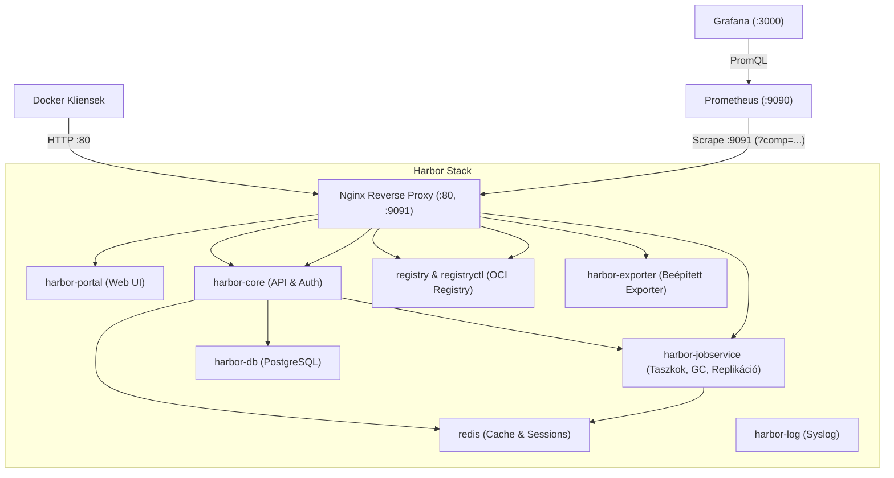

# Harbor Registry & Monitoring Útmutató

Ez a dokumentum részletesen összefoglalja a **Harbor v2.9.2** konténer-regisztráció működését, elérését, a Docker kliensek beállítását, a Prometheus natív metrika-gyűjtését, valamint a Grafana dashboardok beállítását.

---

## 1. Rendszer- és Architektúra Áttekintés

A Harbor nem egyetlen konténer, hanem egy mikroszolgáltatás-alapú stack, amelyet az `/opt/harbor` könyvtárban lévő Docker Compose vezérel a `192.168.100.18` hoston.



### Főbb komponensek:
* **nginx (proxy):** A belépési pont. A 80-as porton fogadja a Web UI-t és a Docker push/pull kéréseket, a 9090/9091-es belső porton pedig a metrika kéréseket route-olja.
* **harbor-core:** A központi üzleti logika, REST API, projektkezelés, kvóták, felhasználók és jogosultságok kezelése.
* **registry (photon):** Maga az OCI/Docker registry motor, ami a rétegeket tárolja és kiszolgálja.
* **harbor-jobservice:** Háttérfeladatok ütemezője és végrehajtója (Garbage Collection, sweep taszkok, replikációk, webhookok).
* **harbor-exporter:** A Harbor hivatalos, beépített Prometheus exportere.

---

## 2. Harbor Elérés és Hitelesítés

### Belépési adatok
* **Webfelület címe:** [http://192.168.100.18](http://192.168.100.18) (Port: `80`, HTTP)
* **Felhasználónév:** `admin`
* **Jelszó:** `Harbor12345`

> [!IMPORTANT]
> A Harbor jelenleg HTTP-n (nem HTTPS-en) üzemel. A Docker démonok alapértelmezés szerint megkövetelik a HTTPS-t a regisztrációktól, kivéve a `127.0.0.1` és `localhost` címeket.

### Kliens gép konfigurálása külső gépről (pl. saját gép / másik szerver)
Ha nem a `192.168.100.18` gépen helyileg, hanem saját laptopról vagy másik node-ról akarsz pusholni vagy pullolni, a Dockernek meg kell mondani, hogy ezt az IP-t engedélyezze titkosítatlanul:

1. Szerkeszd a kliens gép `/etc/docker/daemon.json` (Macen: `~/.docker/daemon.json` vagy Docker Desktop beállítások -> Docker Engine) fájlját:
   ```json
   {
     "insecure-registries": ["192.168.100.18"]
   }
   ```
2. Indítsd újra a Docker daemont:
   ```bash
   sudo systemctl restart docker
   ```
3. Jelentkezz be:
   ```bash
   docker login 192.168.100.18 -u admin -p Harbor12345
   ```

### Munkafolyamat példák (Push & Pull)
```bash
# Image címkézése a Harbor projektnek megfelelően
docker tag my-service:latest 192.168.100.18/homelab/my-service:v1.0

# Feltöltés a Harborba
docker push 192.168.100.18/homelab/my-service:v1.0

# Letöltés a Harborból
docker pull 192.168.100.18/homelab/my-service:v1.0
```

---

## 3. A Harbor Monitoring Architektúrája

### Gyári Exporter vs. c4po/harbor_exporter
A felmérés és tesztek során megvizsgáltuk mind a Harbor gyári exporterét, mind a harmadik féltől származó `c4po/harbor_exporter`-t:

| Tulajdonság | Gyári Harbor Exporter (`v2.9.2`) | `c4po/harbor_exporter` (v0.5.8) |
| :--- | :--- | :--- |
| **Integráció módja** | Natívan beépített a Harbor stackbe (`harbor.yml`) | Külön külső konténerként kell futtatni |
| **Port** | `http://192.168.100.18:9091/metrics` | `http://192.168.100.18:9107/metrics` |
| **Hitelesítés** | Belső csatornán kapja az adatokat (nem kell jelszó a scrapeléshez) | REST API jelszót igényel (`admin:Harbor12345`) |
| **Harbor 2.x kompatibilitás** | **100% natív** | Részleges: a Harbor 2.x API változások miatt a `/scans` 412 hibát ad, a volume lemezméretek unmarshal-ja elbukik |
| **Részletes belső adatok** | Core API latenciák, Registry I/O, Jobservice taszkok | Csak külső API statisztikák |
| **Ajánlás** | **Erősen ajánlott, végleges megoldás** | Nem ajánlott modern Harbor v2.x-hez |

---

## 4. A 4 Natív Metrika Végpont és Bekötésük a Prometheusba

A Harbor Nginx proxyja a `9091`-es porton a `comp` query paraméter alapján választja ki, melyik alrendszer metrikáit adja vissza.

### A 4 végpont:
1. **`http://192.168.100.18:9091/metrics` (harbor-exporter):**
   * Komponensek állapota: `harbor_up{component="core|database|jobservice|portal|redis|registry|registryctl"}`
   * Rendszer egészség: `harbor_health`
   * Projektek száma: `harbor_project_total`
   * Repository-k száma: `harbor_project_repo_total`
   * Artifactok száma: `harbor_project_artifact_total`
   * Lemez- és kvótahasználat: `harbor_project_quota_usage_byte`

2. **`http://192.168.100.18:9091/metrics?comp=core` (harbor-core):**
   * REST API kérések: `harbor_core_http_request_total`
   * Válaszidők: `harbor_core_http_request_duration_seconds`
   * Párhuzamos folyamatok: `harbor_core_http_inflight_requests`

3. **`http://192.168.100.18:9091/metrics?comp=registry` (harbor-registry):**
   * Registry HTTP kérések: `registry_http_requests_total`
   * Kérés- és válaszméretek: `registry_http_request_size_bytes`, `registry_http_response_size_bytes`
   * Tároló műveletek ideje: `registry_storage_action_seconds`

4. **`http://192.168.100.18:9091/metrics?comp=jobservice` (harbor-jobservice):**
   * Háttérfeladatok száma: `harbor_jobservice_task_total`
   * Taszkok feldolgozási ideje: `harbor_jobservice_task_process_time_seconds`
   * Jobservice infó & munkaszálak: `harbor_jobservice_info`

---

## 5. Prometheus Konfiguráció

A szerveren a `/opt/prometheus/prometheus.yml` fájlban és a lokális repóban lévő `prometheus/prometheus.yml` fájlban az alábbi 4 scrape job van beállítva:

```yaml
  # --- Harbor Exporter & Rendszerállapot ---
  - job_name: "harbor"
    scrape_interval: 15s
    static_configs:
      - targets: ["192.168.100.18:9091"]

  # --- Harbor Core API forgalom & válaszidők ---
  - job_name: 'harbor-core'
    scrape_interval: 15s
    params:
      comp: ['core']
    static_configs:
      - targets: ['192.168.100.18:9091']

  # --- Harbor Registry Docker push/pull forgalom & I/O ---
  - job_name: 'harbor-registry'
    scrape_interval: 15s
    params:
      comp: ['registry']
    static_configs:
      - targets: ['192.168.100.18:9091']

  # --- Harbor Jobservice háttértaszkok & ütemező ---
  - job_name: 'harbor-jobservice'
    scrape_interval: 15s
    params:
      comp: ['jobservice']
    static_configs:
      - targets: ['192.168.100.18:9091']
```

### Prometheus újratöltése újraindítás nélkül (SIGHUP)
Ha a konfigurációt módosítod, nem kell a Prometheust leállítani:
```bash
docker kill -s SIGHUP prometheus
```

### Gyors státusz lekérdezés:
A Prometheus Web API-n mind a 4 job státusza **UP**:
```bash
curl -s http://192.168.100.18:9090/api/v1/targets | grep -E 'harbor'
```

---

## 6. Grafana Dashboardok Importálása

A Grafana a `http://192.168.100.18:3000` porton érhető el.

### 1. Opció: Hivatalos GoHarbor Dashboard (Ajánlott)
* **Letöltés:** [metrics-example.json a GitHubról](https://raw.githubusercontent.com/goharbor/harbor/main/contrib/grafana-dashboard/metrics-example.json)
* **Lépések:**
  1. Kattints a Grafanában a bal oldali menüben: **Dashboards -> New -> Import**.
  2. Kattints az **Upload JSON file** gombra, és válaszd ki a letöltött `metrics-example.json` fájlt.
  3. A felugró ablakban válaszd ki a meglévő **Prometheus** adatforrást.
  4. Kattints az **Import** gombra.

### 2. Opció: Grafana.com Dashboards (ID alapján)
* **Harbor 2.x Dashboard:** ID **`15792`** ([Link](https://grafana.com/grafana/dashboards/15792))
* **Harbor Overview:** ID **`19716`** ([Link](https://grafana.com/grafana/dashboards/19716))
* **Lépések:**
  1. Grafana -> **Dashboards -> Import**.
  2. Az **Import via grafana.com** mezőbe írd be a `15792` vagy `19716` azonosítót, majd kattints a **Load** gombra.
  3. Válaszd ki a Prometheus adatforrásodat, majd **Import**.

---

## 7. Feltöltött Projektek és Repository-k (Összesen 24 Repository)

A monitoring teszteléséhez és a dashboardok feltöltéséhez 4 külön projektben összesen 24 repository és image verzió lett létrehozva kis méretű rétegekkel:

| Projekt | Repository | Verziók / Címkék |
| :--- | :--- | :--- |
| **`homelab`** (10 repo) | `homelab/api-gateway` | `:v1.0.0`, `:v2.0.0`, `:latest` |
| | `homelab/frontend` | `:v1.0`, `:latest` |
| | `homelab/worker` | `:latest` |
| | `homelab/db-backup` | `:v1.0` |
| | `homelab/auth-service` | `:v1.0.0`, `:v1.1.0` |
| | `homelab/notification-service` | `:v1`, `:latest` |
| | `homelab/payment-mock` | `:v1` |
| | `homelab/metrics-collector` | `:v0.2` |
| | `homelab/event-bus` | `:v1` |
| | `homelab/search-indexer` | `:v1` |
| **`infra`** (6 repo) | `infra/traefik-custom` | `:v2.10` |
| | `infra/postgres-backup` | `:v15` |
| | `infra/redis-sentinel` | `:v7` |
| | `infra/dns-sync` | `:v1.0` |
| | `infra/cert-renewer` | `:v1.2` |
| | `infra/wireguard-helper` | `:v1` |
| **`tools`** (5 repo) | `tools/toolbox` | `:v1.0`, `:latest` |
| | `tools/curl-jq` | `:latest` |
| | `tools/net-debug` | `:v1` |
| | `tools/speedtest-exporter` | `:v1` |
| | `tools/mqtt-cli` | `:v1` |
| **`library`** (3 repo) | `library/alpine` | `:3.19`, `:latest` |
| | `library/busybox` | `:1.36`, `:latest` |
| | `library/test-app` | `:v1` |

---

## 8. Ansible Playbook Karbantartás

A Harbor telepítését és frissítését az `ansible/harbor/harbor.yml` kezeli.

### Futtatás az Ansible környezetből:
```bash
cd ansible

# Virtuális környezet aktiválása
source .venv/bin/activate

# Futtatás szárazon (dry-run / check mode):
ansible-playbook harbor/harbor.yml -i inventory --check

# Éles futtatás:
ansible-playbook harbor/harbor.yml -i inventory
```
